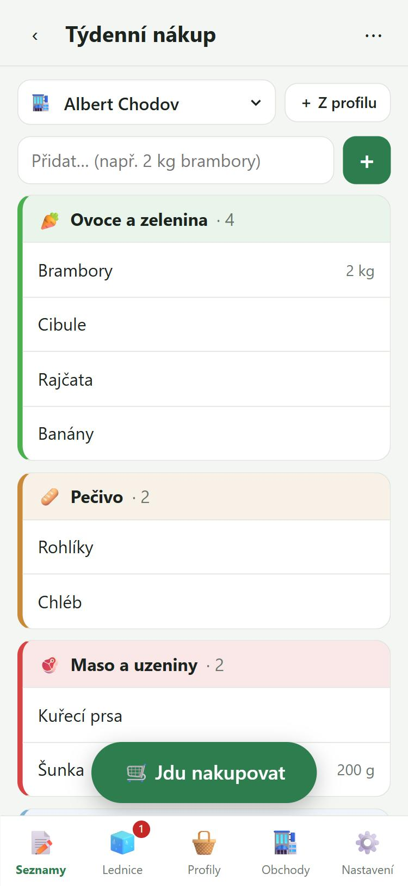
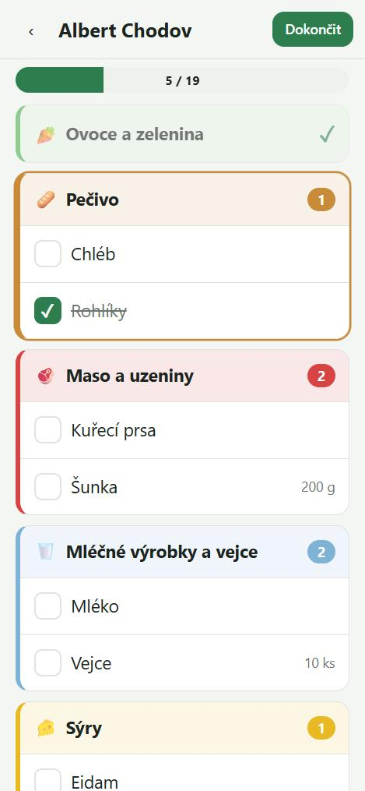
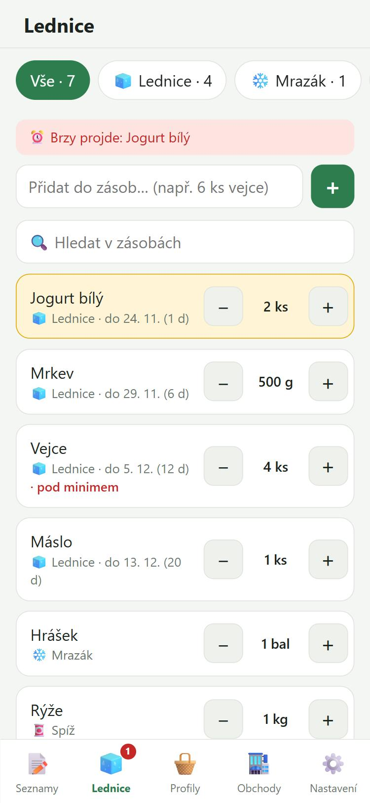
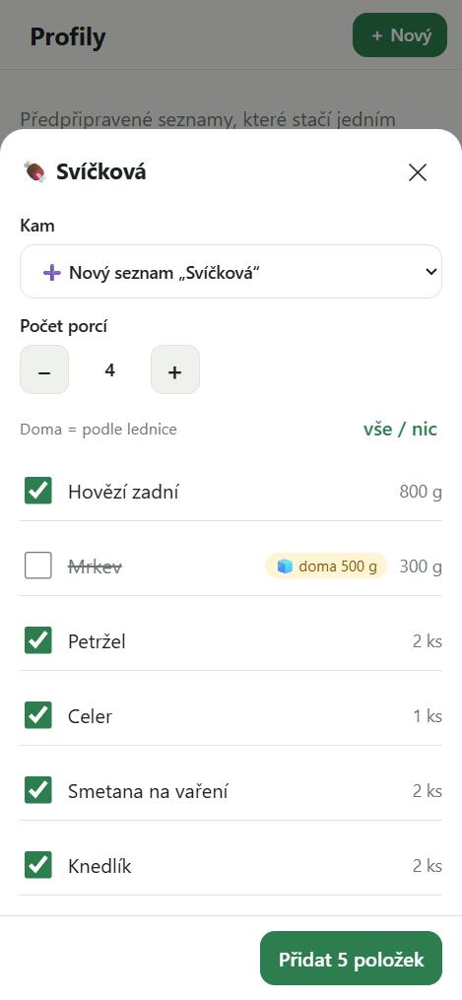
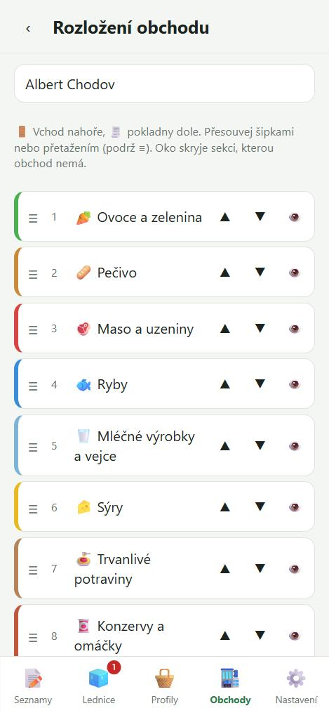
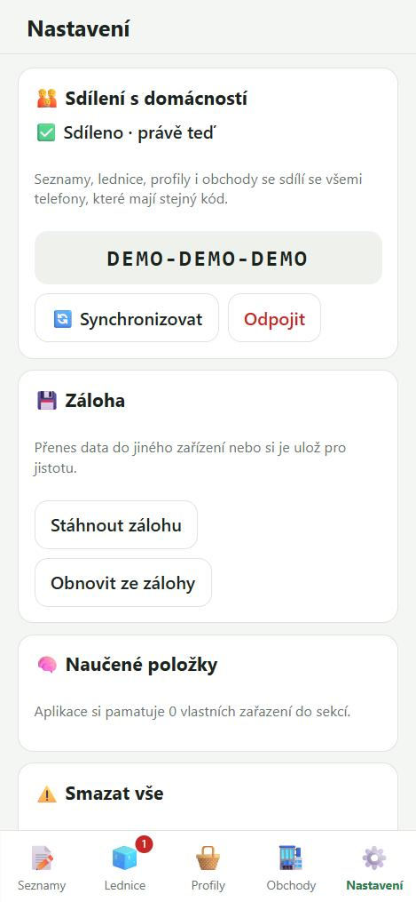

# 🛒 Nákupák – chytrý nákupní seznam

Webová aplikace pro mobil, která řadí nákupní seznam **podle toho, jak jsou sekce rozmístěné
v obchodě**. Obchodem tak projdete jednou od vchodu k pokladnám a nestane se, že na konci
zjistíte, že vám chybí cibule, která je hned u vchodu.

K tomu hlídá, **co máte doma v lednici**, umí **předpřipravené nákupy (profily)** a seznamy
i lednici **sdílí mezi telefony** celé domácnosti. Běží na vlastním webu s WordPressem jako
plugin a na iPhonu či Androidu se používá přes zástupce na ploše.

<p align="center">
  
  
  
</p>
<p align="center">
  
  
  
</p>

## Co umí

| | |
|---|---|
| 📝 **Seznamy** | Položku stačí napsat („2 kg brambory“), aplikace ji sama zařadí do sekce obchodu. Lze vložit i celý seznam najednou. Neznámou položku si po prvním zařazení zapamatuje. |
| 🛒 **Nákupní režim** | Sekce v pořadí průchodu obchodem, velké odškrtávací plochy, ukazatel postupu, hotové sekce se sbalí. Displej během nákupu nezhasne. |
| 🧊 **Lednice** | Zásoby doma podle místa (lednice, mrazák, spíž), hlídání data spotřeby, minimální zásoba, která se sama doplní na seznam. Při psaní seznamu upozorní: „to máš doma“. |
| 🧺 **Profily** | Uložené nákupy („Snídaně“, „Svíčková pro 4“), které se jedním klepnutím vloží do seznamu. Co je doma, se předem odškrtne. Recepty přepočítají množství podle počtu porcí. |
| 🏬 **Obchody** | Každý obchod má vlastní pořadí sekcí. Sekce lze skrýt, přejmenovat nebo přidat vlastní. |
| 👪 **Sdílení** | Telefony se stejným **kódem domácnosti** sdílí vše. Změny se projeví do pár sekund, aplikace funguje i bez signálu. |

## Rychlý start

**Chci aplikaci na svém webu s WordPressem:**
stáhněte `nakupak-wordpress-plugin.zip` ze stránky [Releases](https://github.com/PokRom/nakupak/releases) (nebo ho
[sestavte ze zdrojového kódu](docs/INSTALACE.md#sestavení-ze-zdrojového-kódu)) a nahrajte ho
ve WordPressu přes **Pluginy → Přidat nový → Nahrát plugin**.
Podrobně v [návodu na instalaci](docs/INSTALACE.md).

**Chci aplikaci jen vyzkoušet na počítači:**

```bash
npm install
npm run dev
```

## Dokumentace

| Dokument | Obsah |
|---|---|
| [Instalace](docs/INSTALACE.md) | Zprovoznění na vlastním webu, sestavení ze zdrojového kódu, aktualizace, řešení problémů |
| [Uživatelská příručka](docs/UZIVATELSKA-PRIRUCKA.md) | Jak aplikaci používat, sdílení s domácností, zástupce na ploše |
| [Jak to funguje](docs/JAK-TO-FUNGUJE.md) | Technický popis: architektura, datový model, řazení do sekcí, synchronizace, bezpečnost, testy |

## Použité technologie

- **Aplikace:** React 18 a Vite 5, styly v čistém CSS. Žádné další knihovny, data jsou v `localStorage` prohlížeče.
- **Server:** WordPress plugin v PHP s vlastní databázovou tabulkou a jednoduchým synchronizačním API.
- **Nástroje:** pro sestavení a testy je potřeba Node.js 20.11 nebo novější.

## Struktura repozitáře

```
src/                aplikace (React)
  data/             sekce obchodu, slovník potravin, rozpoznávání češtiny
  sync/             synchronizace mezi telefony
  screens/          obrazovky aplikace
  components/       sdílené komponenty
  store.jsx         stav aplikace a napojení synchronizace
public/             ikony, manifest, service worker
wp-plugin/          WordPress plugin (PHP)
scripts/            sestavení pluginu, testy, testovací server, generátor ikony
docs/               dokumentace a snímky obrazovky
```

## Licence

[GPL-2.0-or-later](LICENSE), stejně jako WordPress.
