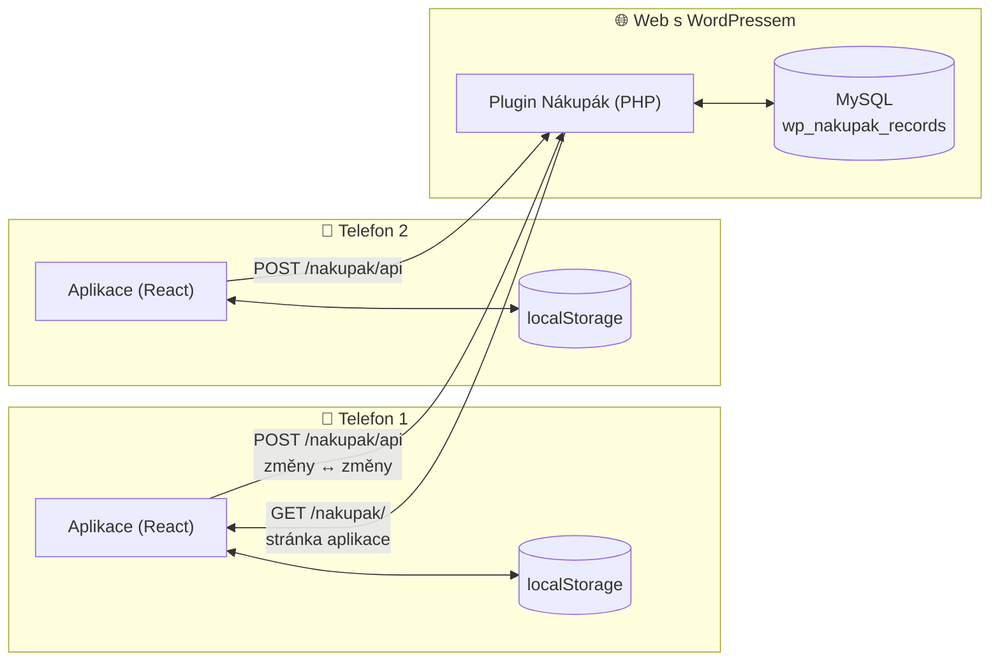
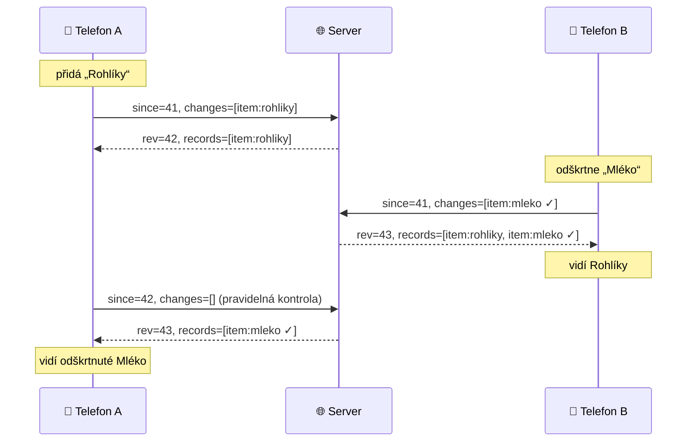

# Jak Nákupák funguje

Technická dokumentace projektu: cíl, architektura, datový model, použité algoritmy,
synchronizace mezi zařízeními, bezpečnost a testování.

**Obsah**

1. [Cíl projektu](#1-cíl-projektu)
2. [Architektura](#2-architektura)
3. [Technologie a proč právě tyto](#3-technologie-a-proč-právě-tyto)
4. [Struktura kódu](#4-struktura-kódu)
5. [Datový model](#5-datový-model)
6. [Řazení položek do sekcí](#6-řazení-položek-do-sekcí)
7. [Řazení podle obchodu](#7-řazení-podle-obchodu)
8. [Lednice a profily](#8-lednice-a-profily)
9. [Ukládání dat v telefonu](#9-ukládání-dat-v-telefonu)
10. [Synchronizace mezi telefony](#10-synchronizace-mezi-telefony)
11. [WordPress plugin](#11-wordpress-plugin)
12. [Bezpečnost](#12-bezpečnost)
13. [Mobil, offline režim a zástupce na ploše](#13-mobil-offline-režim-a-zástupce-na-ploše)
14. [Testování](#14-testování)
15. [Omezení a možná rozšíření](#15-omezení-a-možná-rozšíření)
16. [Postup vývoje](#16-postup-vývoje)

---

## 1. Cíl projektu

**Problém:** běžný nákupní seznam je seřazený tak, jak člověka věci napadly. V obchodě pak
chodí sem a tam, a když na konci u pokladen zjistí, že zapomněl cibuli, musí se vracet až ke
vchodu.

**Řešení:** aplikace každou položku automaticky zařadí do **sekce supermarketu** (zelenina,
pečivo, maso…) a sekce seřadí **v pořadí, v jakém jimi zákazník prochází konkrétním obchodem**.
Nákup se tak zvládne jedním průchodem.

**Další požadavky, které vznikly během vývoje:**

- přehled o tom, **co je doma** (virtuální lednice), dostupný i z obchodu,
- **předpřipravené nákupy** (profily), aby se opakované seznamy nemusely vypisovat znovu,
- **sdílení mezi dvěma telefony** v jedné domácnosti,
- provoz na **vlastním webu s WordPressem**, ovládaný jen přes administraci WordPressu, bez FTP,
- použití na **iPhonu přes zástupce na ploše**, bez App Store.

---

## 2. Architektura

Aplikace je **webová stránka** (single-page application), která běží celá v prohlížeči telefonu.
Server slouží jen k jejímu doručení a k přenosu změn mezi telefony.



Hlavní principy:

- **Offline-first:** telefon má vždy úplnou kopii dat a pracuje s ní okamžitě. Síť je potřeba
  jen pro výměnu změn. Aplikace proto funguje i ve sklepním supermarketu bez signálu.
- **Server je „hloupý“:** jen ukládá záznamy a vrací, co se změnilo. Veškerá logika aplikace
  (řazení, lednice, profily) běží v telefonu.
- **Synchronizace je volitelná:** bez kódu domácnosti je aplikace plně funkční, jen data
  zůstanou v jednom telefonu.

---

## 3. Technologie a proč právě tyto

| Technologie | Použití | Důvod |
|---|---|---|
| **React 18** | uživatelské rozhraní | Komponentový přístup, jednoduchá práce se stavem. Aplikace se mění podle dat (seznam, lednice), což React řeší sám. |
| **Vite 5** | vývojový server a sestavení | Rychlé sestavení, výstup je pár statických souborů, které jde nahrát kamkoli. |
| **Čisté CSS** s proměnnými | vzhled | Bez knihoven. Světlý a tmavý režim se přepíná přes `prefers-color-scheme`. |
| **localStorage** | data v telefonu | Dostupné v každém prohlížeči, data jsou malá (stovky kB). |
| **PHP + WordPress** | server | Uživatel už web s WordPressem měl. Plugin jde nainstalovat přes administraci a WordPress dodá databázi, přihlášení administrátora i správu. |
| **Node.js** | sestavení a testy | Skripty pro zabalení pluginu, testovací server a testy synchronizace. |

Zvažované a zamítnuté alternativy:

- **Nativní aplikace (React Native, Swift):** vyžaduje App Store nebo vývojářský účet, pro
  osobní použití zbytečně složité.
- **Externí databázová služba (Supabase, Firebase):** další účet a závislost na cizí službě.
  WordPress už databázi má.
- **Vložení do stránky WordPressu přes shortcode nebo iframe:** šablona webu by překážela
  a zástupce na ploše iPhonu by nefungoval jako aplikace.

---

## 4. Struktura kódu

| Soubor | Obsah |
|---|---|
| `src/main.jsx` | vstupní bod, registrace service workeru |
| `src/App.jsx` | navigace (spodní lišta), přepínání obrazovek, oznámení |
| `src/store.jsx` | **stav aplikace**: načtení a uložení, funkce `mutate`, pomocné funkce (řazení, lednice), napojení synchronizace (`useSync`) |
| `src/data/sections.js` | výchozí sekce obchodu, místa uložení, jednotky |
| `src/data/dictionary.js` | **slovník** 577 potravin a zboží rozdělených do 17 sekcí |
| `src/data/normalize.js` | **rozpoznávání češtiny**: normalizace, ořez koncovek, zařazení do sekce, rozpoznání množství |
| `src/sync/flat.js` | převod stavu na **ploché záznamy** a zpět, stabilní pořadí |
| `src/sync/engine.js` | **synchronizační logika**: rozdíly, slučování, komunikace se serverem |
| `src/screens/*.jsx` | obrazovky: Seznamy, Detail seznamu, Nákupní režim, Lednice, Profily, Obchody, Nastavení |
| `src/components/ui.jsx` | sdílené komponenty: okno (modal), editor položky, výběr sekce, pole s našeptávačem |
| `wp-plugin/nakupak.php` | **WordPress plugin**: doručení aplikace, API, databáze, administrace |
| `scripts/build-plugin.mjs` | zabalení pluginu do ZIP |
| `scripts/sync-test.mjs` | **automatické testy** synchronizace |
| `scripts/mock-server.mjs` | testovací server se stejným API jako plugin |
| `scripts/make-icon.mjs` | generátor ikony aplikace (PNG bez externích knihoven) |

Celkem přibližně 3 100 řádků kódu.

---

## 5. Datový model

Celý stav aplikace je jeden JavaScriptový objekt:

```js
{
  lists: [{                       // nákupní seznamy
    id, name, storeId, createdAt, o,
    items: [{ id, name, quantity, unit, note, sectionId, checked, o }]
  }],
  pantry: [{                      // lednice (zásoby doma)
    id, name, quantity, unit, sectionId, locationId,
    addedAt, expiresAt, minQuantity, o
  }],
  templates: [{                   // profily
    id, name, emoji, servings, defaultStoreId, o,
    items: [{ id, name, quantity, unit, sectionId, note, o }]
  }],
  stores: [{ id, name, sectionOrder: [sectionId…], hidden: [sectionId…], o }],
  sections:  [{ id, name, icon, color, o }],   // sekce obchodu
  locations: [{ id, name, icon, o }],          // lednice, mrazák, spíž…
  learned:  { "cibul": "zelenina", … },        // naučená zařazení uživatele
  history:  { "mlek": { name, count, sectionId }, … },  // pro našeptávač
  activeStoreId                                // naposledy zvolený obchod (jen v telefonu)
}
```

- `id` je náhodný řetězec (`uid()`), takže dva telefony mohou vytvářet záznamy nezávisle bez
  kolizí.
- `o` je **pořadí**. Číslo přidělené při vytvoření (čas v ms) určuje pořadí položek stejně na
  všech telefonech, viz [kapitolu 10](#10-synchronizace-mezi-telefony).
- Klíče v `learned` a `history` jsou **normalizované názvy** (viz kapitola 6).

---

## 6. Řazení položek do sekcí

Jádro aplikace: z textu „cibuli“ poznat, že patří do sekce **Ovoce a zelenina**.

### 6.1 Normalizace textu

Funkce `normalizeName()` v `src/data/normalize.js` převede název na **kmen**, který je stejný
pro různé tvary slova:

1. **malá písmena**: „Cibuli“ → „cibuli“,
2. **odstranění diakritiky** (Unicode NFD a smazání kombinujících znaků): „kuřecí“ → „kureci“,
3. **jen písmena, číslice a jednoduché mezery**,
4. **ořez české koncovky** u každého slova. Zkouší se od nejdelší a ořízne se jen tehdy, když
   zůstanou aspoň 3 znaky:
   `ovymi, ami, emi, ech, ich, ych, ach, ove, ova, ovi, ou, em, um, y, i, e, u, a, o`.

| Vstup | Po normalizaci |
|---|---|
| Cibule, cibuli, cibulí | `cibul` |
| Mléko, mléka, mlékem | `mlek` |
| Kuřecí prsa | `kurec prs` |
| Rohlíky | `rohlik` |

Nejde o plnohodnotnou lingvistickou analýzu, ale pro názvy potravin to stačí a funguje to bez
externích knihoven. Tvary, které se tímto způsobem nesjednotí (např. „rajče“ / „rajčata“), jsou
ve slovníku uvedené zvlášť.

### 6.2 Slovník

`src/data/dictionary.js` obsahuje 577 výrazů ve 17 sekcích. Při startu se z něj sestaví
**index** `normalizovaný název → sekce` (`Map`), takže vyhledání trvá konstantní čas.

### 6.3 Algoritmus zařazení

Funkce `classify(name, learned)`:

```
1. klíč = normalizeName(name)
2. pokud uživatel klíč dříve ručně zařadil (learned)  → vrať jeho sekci
3. pokud je celý klíč ve slovníku                     → vrať sekci
4. pro délku d od (počet slov − 1) do 1:              ← nejdelší shoda vyhrává
       pro každou souvislou skupinu d slov:
           pokud je v learned nebo ve slovníku        → vrať sekci
5. jinak null → aplikace se uživatele zeptá a odpověď uloží do learned
```

Příklady:

- „červená cibule“ → celý výraz je ve slovníku → zelenina,
- „čerstvá cibule z trhu“ → najde se podskupina „cibule“ → zelenina,
- „tempeh“ (ve slovníku není) → zeptá se → uloží `learned["tempeh"] = "maso"` a příště už
  rozhodne sama.

Naučená zařazení mají přednost před slovníkem, takže uživatel může i opravit sekci, se kterou
nesouhlasí. Stačí položku přesunout do jiné sekce.

### 6.4 Rozpoznání množství

`parseItem()` rozpozná množství na začátku i na konci textu pomocí regulárních výrazů:

| Vstup | Název | Množství | Jednotka |
|---|---|---|---|
| `2 kg brambory` | brambory | 2 | kg |
| `mouka 1kg` | mouka | 1 | kg |
| `10 ks vejce` | vejce | 10 | ks |
| `chleba` | chleba | – | – |

`parseBulk()` rozdělí vložený text podle čárek, středníků a řádků. Funguje tak vložení celého
seznamu, třeba zkopírovaného ze zprávy.

### 6.5 Sloučení duplicit

`addItemToList()` při přidání hledá nevyřízenou položku se stejným normalizovaným názvem
a jednotkou. Pokud ji najde, množství sečte místo vytvoření druhého řádku.

---

## 7. Řazení podle obchodu

Každý obchod má pole `sectionOrder` (pořadí sekcí od vchodu) a `hidden` (sekce, které nemá).

- `orderedSections(state, storeId)` vrátí viditelné sekce v pořadí obchodu. Sekce přidané
  později, které obchod ještě nezná, vloží před Pokladnu.
- `groupBySection(state, storeId, items)` rozdělí položky do skupin podle sekcí v tomto pořadí.
  Položky ze skryté sekce spadnou do „Ostatní“, prázdné skupiny vynechá.

Nákupní režim navíc určuje **aktuální sekci**, tedy první, ve které zbývá něco nekoupeného,
a zvýrazní ji. Hotové sekce sbalí.

---

## 8. Lednice a profily

### Lednice

- **Napojení na seznam:** `findInPantry()` hledá zásobu se stejným normalizovaným názvem nebo
  takovou, jejíž název je jedním ze slov hledaného výrazu („Máslo“ odpovídá i „máslo
  bio“). Používá se pro upozornění „Doma máš…“ při psaní a pro odškrtnutí v profilech.
- **Datum spotřeby:** `daysLeft()` počítá celé dny do data spotřeby. 2 dny a méně je žlutě,
  prošlé červeně, počet těchto zásob se zobrazuje na záložce.
- **Minimální zásoba:** `checkMinimum()` se volá při každé změně množství. Když zásoba klesne
  pod minimum a položka ještě není na seznamu, přidá chybějící množství na první seznam
  (případně vytvoří seznam „Doplnit zásoby“).
- **Po nákupu** se koupené položky převedou na zásoby. Místo uložení se odhadne podle sekce
  (mléčné → lednice, mražené → mrazák, trvanlivé → spíž) a stejné zásoby se sečtou.

### Profily

Profil je seznam položek s výchozím množstvím. Při použití (`ApplyTemplate.jsx`):

1. každá položka se porovná s lednicí a **co je doma, je předem odškrtnuté**,
2. má-li profil počet porcí, množství se násobí poměrem `zvolené porce / porce profilu`,
3. vybrané položky se přidají přes `addItemToList()`, takže se sloučí s tím, co už na
   seznamu je.

---

## 9. Ukládání dat v telefonu

- Stav je v Reactu (`useState`) a po každé změně se celý uloží do `localStorage` jako JSON.
- Změny se zapisují funkcí `mutate(fn)`: ta udělá **hlubokou kopii** stavu
  (`structuredClone`), na ní spustí úpravu a výsledek nastaví jako nový stav. Kód úprav je tak
  jednoduchý (`d.pantry.push(…)`) a React přesto dostane nový objekt. Při velikosti dat ve
  stovkách kB je kopie zanedbatelně rychlá.
- Po každé změně `stampOrder()` doplní pořadí `o` u nových záznamů (viz níže).
- Při načtení se uložená data spojí s výchozím stavem, takže nová verze aplikace s novými poli
  umí načíst data ze starší verze.

---

## 10. Synchronizace mezi telefony

Nejsložitější část projektu. Požadavky:

1. dva telefony mohou **upravovat současně** a změny se nesmí ztratit,
2. musí to fungovat **bez signálu** a dorovnat se po připojení,
3. server je běžný WordPress hosting: žádné WebSockety, jen HTTP požadavky,
4. přenáší se **jen změny**, ne pokaždé všechna data.

### 10.1 Ploché záznamy

Kdyby se synchronizoval celý seznam jako jeden celek, dva lidé upravující různé položky
stejného seznamu by si změny přepsali. Stav se proto před synchronizací rozloží na **ploché
záznamy**, jeden pro každou věc (`src/sync/flat.js`):

| Klíč záznamu | Obsah |
|---|---|
| `list:<id>` | seznam bez položek (název, obchod…) |
| `item:<id>` | jedna položka seznamu + `listId` |
| `tpl:<id>` / `tpli:<id>` | profil / položka profilu + `templateId` |
| `pan:<id>` | jedna zásoba v lednici |
| `store:<id>`, `sec:<id>`, `loc:<id>` | obchod, sekce, místo uložení |
| `learn:<klíč>`, `hist:<klíč>` | naučené zařazení, historie nákupů |

Hodnota záznamu je JSON se **seřazenými klíči** (`stableStringify`), takže stejná data dají
vždy stejný text a záznamy jde porovnávat obyčejným porovnáním řetězců.

`unflatten()` dělá opak: z položek s `listId` poskládá seznamy. Pořadí určí pole `o`, které
se přidělí jednou při vytvoření. **Pořadí tak nezávisí na pozici v poli**, a smazání první
položky proto nezmění všechny ostatní záznamy.

### 10.2 Princip: base a rozdíl

Každý telefon si pamatuje **`base`**, tedy jak podle něj vypadají data na serveru, a **`rev`**,
tedy číslo poslední revize, kterou ze serveru zná.

- **Lokální změny** = rozdíl mezi aktuálním stavem a `base` (`diff()`): nové a změněné
  záznamy plus smazané (jsou v `base`, ale už ne ve stavu).
- Tento přístup nepotřebuje evidovat každou úpravu zvlášť. Stačí porovnat dva stavy, a funguje
  proto i po libovolně dlouhé době bez signálu.

### 10.3 Protokol

Jediný požadavek `POST /nakupak/api` odešle změny a zároveň stáhne změny ostatních:

```json
// požadavek
{
  "since": 41,
  "code": "K7QMXWPH9TD3",
  "changes": [
    { "k": "item:x8f2k1", "d": "{\"checked\":true,\"id\":\"x8f2k1\",\"listId\":\"a1\",\"name\":\"Mléko\",…}" },
    { "k": "pan:q2w3e4",  "d": null }
  ]
}

// odpověď
{
  "rev": 42,
  "full": false,
  "records": [
    { "k": "item:x8f2k1", "d": "{…}" },
    { "k": "item:z9y8x7", "d": "{…od druhého telefonu…}" },
    { "k": "pan:q2w3e4",  "d": null }
  ]
}
```

- `d: null` znamená **smazáno**. Server si smazání pamatuje jako takzvaný tombstone, aby se
  o něm dozvěděly i ostatní telefony.
- Server přidělí každé dávce změn **nové číslo revize** a vrátí všechny záznamy s revizí vyšší
  než `since`, včetně právě odeslaných.
- `full: true` znamená, že server posílá **všechna živá data**, ne jen změny. Stane se to
  při prvním připojení, po úklidu starých tombstonů nebo když je revize telefonu vyšší než
  serverová (databáze obnovená ze zálohy).



### 10.4 Řešení konfliktů

- **Různé záznamy** (A přidá rohlíky, B odškrtne mléko): nejde o konflikt, obě změny se
  uloží, protože každá položka je samostatný záznam.
- **Stejný záznam** (oba změní množství téže položky): platí **poslední zápis** (last-writer-wins)
  podle pořadí, v jakém změny dorazily na server. Rozhoduje revize serveru, ne hodiny
  v telefonech, takže nevadí, když má telefon špatně nastavený čas.
- **Smazaný seznam, jehož položku druhý telefon mezitím upravil:** položka zůstane bez
  seznamu, `unflatten()` ji vynechá a při další synchronizaci se smaže. Oba telefony skončí ve
  stejném stavu.

### 10.5 Slučování odpovědi s lokálním stavem

Během čekání na odpověď může uživatel dál psát. Funkce `merge()` proto pracuje se třemi stavy:

- `sent`: stav v okamžiku odeslání,
- `current`: stav teď, když přišla odpověď,
- `records`: co vrátil server.

```
pro každý záznam ze serveru:
    pokud current[k] ≠ sent[k]:     ← uživatel ho mezitím upravil
        přeskoč (jeho úprava se odešle v dalším kole a vyhraje)
    jinak:
        převezmi verzi ze serveru (nebo smaž, je-li d = null)

pokud full:
    záznam, který byl v base, lokálně se nezměnil a na serveru už není → smaž
    (někdo ho smazal a server o tom už nemá tombstone)
```

Nový `base` se spočítá jen z odpovědi serveru (`computeBase()`), nezávisle na lokálních úpravách.

### 10.6 Kdy se synchronizuje

| Událost | Zpoždění |
|---|---|
| lokální změna | 0,7 s (víc rychlých změn se odešle v jednom požadavku) |
| pravidelná kontrola, když je aplikace na obrazovce | každých 5 s |
| návrat do aplikace, obnovení signálu | hned |

Současně běží vždy nejvýš jeden požadavek. Pokud během něj přijde další podnět, synchronizace
proběhne hned po jeho dokončení.

### 10.7 První připojení telefonu

Telefon nejdřív pošle `since = 0` bez změn, tím ověří kód a zjistí, kolik dat je na serveru.

- **Server je prázdný:** data telefonu se nahrají.
- **Server už má data:** uživatel zvolí
  - *Použít jen sdílená data*: lokální data se nahradí serverovými, `base` = data serveru,
  - *Spojit s daty v telefonu*: serverová data se převezmou, lokální záznamy, které na serveru
    nejsou, se v dalším kole odešlou.

### 10.8 Úklid smazaných záznamů

Tombstony by v tabulce zůstávaly navždy. Plugin je proto přibližně při každém 50. požadavku
**smaže, pokud jsou starší 30 dní**, a nejvyšší smazanou revizi si uloží (`nakupak_purged_rev`).
Telefon s revizí nižší, než je tato hodnota, by se o některých smazáních nedozvěděl, a proto
dostane `full: true` a smazané záznamy si dopočítá podle 10.5.

---

## 11. WordPress plugin

`wp-plugin/nakupak.php`, jeden soubor PHP, přibližně 390 řádků.

### Doručení aplikace

- **Přepisovací pravidla** WordPressu (`add_rewrite_rule`) mapují `/nakupak/`, `/nakupak/sw.js`,
  `/nakupak/manifest.json` a `/nakupak/api` na parametr `nakupak`.
- V háčku `template_redirect` plugin podle parametru:
  - vrátí `index.html` aplikace, ve kterém **přepíše cesty** ke skriptům, stylům a ikonám na
    složku pluginu (`/wp-content/plugins/nakupak/app/…`),
  - vrátí service worker ze stejné adresy jako aplikace, protože jen tak smí obsluhovat
    `/nakupak/`,
  - vygeneruje manifest s absolutními adresami ikon,
  - obslouží API.
- Všechny odpovědi posílají hlavičky proti ukládání do mezipaměti a nastavují `DONOTCACHEPAGE`,
  aby cache pluginy nedoručovaly starou verzi.

### Databáze

```sql
CREATE TABLE wp_nakupak_records (
  k       varchar(191) NOT NULL,    -- klíč záznamu, např. item:x8f2k1
  data    longtext NULL,            -- JSON záznamu
  deleted tinyint(1) NOT NULL DEFAULT 0,
  rev     bigint unsigned NOT NULL DEFAULT 0,
  updated datetime NOT NULL,
  PRIMARY KEY (k),
  KEY rev (rev)                     -- rychlé „co se změnilo od revize X“
);
```

- Zápis používá `REPLACE`, takže stejný klíč se přepíše.
- **Číslo revize** je ve volbě `nakupak_rev`. Aby dva současné požadavky nedostaly stejnou
  revizi, celý zápis probíhá pod databázovým zámkem `GET_LOCK('nakupak_sync')`.
- Revize se čte přímo dotazem do databáze, ne přes cache voleb WordPressu, aby nebyla zastaralá.

### Instalace a aktualizace

- Při aktivaci se vytvoří tabulka (`dbDelta`), vygeneruje kód a obnoví přepisovací pravidla.
- Při nahrání nové verze přes „Nahradit stávající“ WordPress aktivační háček **nespouští**.
  Plugin proto při každém načtení porovná verzi schématu (`NAKUPAK_SCHEMA`) a v případě změny
  instalaci zopakuje.

### Administrace

Stránka **Nastavení → Nákupák** zobrazuje kód domácnosti, počet a velikost uložených záznamů
a tlačítka *Vytvořit nový kód* a *Smazat sdílená data*. Formuláře jsou chráněné kontrolou
oprávnění (`manage_options`) a nonce proti CSRF.

---

## 12. Bezpečnost

| Hrozba | Ochrana |
|---|---|
| Cizí člověk čte nebo mění data | Každý požadavek API musí obsahovat **kód domácnosti**. Ten má 12 znaků z 31znakové abecedy (bez zaměnitelných 0/O, 1/I/L), tedy 31¹² ≈ 7,9 × 10¹⁷ možností, a generuje se kryptograficky bezpečným `random_int`. |
| Hádání kódu (brute force) | Po 20 chybných pokusech z jedné IP adresy za hodinu server odpovídá `429`. Správný kód se neblokuje nikdy, aby útočník nezablokoval domácnost sdílející s ním IP adresu. |
| Časový útok na porovnání kódu | Porovnání přes `hash_equals` (konstantní čas). |
| SQL injection | Všechny dotazy s proměnnými přes `$wpdb->prepare`, `$wpdb->replace` s formáty. |
| Nadměrně velké požadavky | Nejvýš 10 000 změn v jednom požadavku, nejvýš 200 kB na záznam, kontrola formátu klíče. |
| Zneužití administrace | Kontrola oprávnění a nonce u formulářů, escapování výstupu (`esc_html`, `esc_url`). |
| Odposlech | Doporučený provoz na HTTPS. Kód se posílá v hlavičce a v těle požadavku, nikdy v adrese URL. |
| Indexace vyhledávači | Stránka aplikace má `noindex`. |

**Známá omezení zabezpečení:** kód je jedno sdílené tajemství. Nerozlišuje se, kdo co změnil,
a kdo kód zná, má plný přístup. Při úniku je potřeba vytvořit nový kód. Data v telefonu jsou
v `localStorage` nešifrovaná, chrání je stejně jako ostatní data prohlížeče jen zámek telefonu.

---

## 13. Mobil, offline režim a zástupce na ploše

- **Zástupce na ploše iPhonu:** meta značky `apple-mobile-web-app-capable` a
  `apple-touch-icon` (PNG 180 × 180). Aplikace z plochy se otevře bez adresního řádku.
- **Ikona** se generuje skriptem `make-icon.mjs`: vlastní vykreslení košíku s vyhlazováním
  (supersampling 4 × 4) a ruční zápis PNG (zlib + CRC32), bez grafických knihoven.
- **Service worker** (`sw.js`) používá strategii **síť napřed, při výpadku mezipaměť**. Když je
  signál, vždy se načte aktuální verze, a bez signálu se aplikace spustí z mezipaměti.
- **Nezhasínání displeje** v nákupním režimu přes Screen Wake Lock API, kde ho prohlížeč
  podporuje.
- **Ovládání jednou rukou:** dotykové plochy nejméně 44 px, v nákupním režimu 58 px.
- **Tmavý režim** podle nastavení telefonu.

---

## 14. Testování

### Automatické testy synchronizace

`npm test` spustí `scripts/sync-test.mjs`. Simuluje server se stejnými pravidly jako PHP plugin
a dva až tři telefony, které používají **skutečný kód aplikace** (`flat.js`, `engine.js`).
Testované scénáře:

1. první telefon nahraje data na prázdný server,
2. druhý telefon s volbou „jen sdílená data“ má po připojení totéž co první,
3. současné změny různých položek se neztratí,
4. pořadí položek je na obou telefonech stejné,
5. smazání se propíše na druhý telefon,
6. úprava provedená během čekání na server se nepřepíše,
7. stejná položka upravená na obou telefonech: vyhraje pozdější zápis a telefony se shodnou,
8. smazaný seznam, jehož položku druhý telefon mezitím upravil, zmizí na obou,
9. telefon, který byl offline během úklidu tombstonů, dostane úplný stav a nepřijde o nové lokální položky,
10. spojení dat: třetí telefon přidá svá data ke sdíleným,
11. kolo bez změn nic neodešle a stav nezmění.

Výsledek: **11 / 11 testů prošlo.**

### Testovací server a dva „telefony“ v prohlížeči

`npm run mock` spustí server (`scripts/mock-server.mjs`), který doručuje sestavenou aplikaci
stejně jako plugin a implementuje stejné API. Dva telefony se simulují dvěma adresami
(`localhost` a `127.0.0.1`), které mají v prohlížeči oddělená úložiště. Ručně ověřené scénáře:

- špatný kód je odmítnut se srozumitelnou chybou,
- druhý telefon po připojení zobrazí seznam prvního,
- položka přidaná na jednom telefonu se během pár sekund objeví na druhém (i v nákupním režimu),
- odškrtnutí v obchodě se propíše na druhý telefon,
- nákup uložený do lednice na jednom telefonu je vidět v lednici druhého,
- bez připojení se zobrazí stav „Bez připojení“ a po obnovení se změny odešlou.

### Další ruční testy

- rozpoznání sekcí na vzorku běžných položek včetně skloňování,
- zobrazení na šířce mobilu (375 px) a ve světlém i tmavém režimu,
- doručení aplikace z podsložky a s cestami přepsanými na složku pluginu.

---

## 15. Omezení a možná rozšíření

**Omezení současné verze:**

- jeden kód domácnosti na web (více domácností by vyžadovalo oddělená data),
- zařazení do sekcí je založené na slovníku a jednoduchém ořezu koncovek, takže
  nezná všechny tvary,
- konflikt na stejné položce se řeší „poslední vyhrává“, nikoli sloučením jednotlivých polí,
- synchronizace se dotazuje každých 5 s (polling), změny proto nejsou úplně okamžité,
- upozornění na prošlé potraviny se ukazují jen v aplikaci, nechodí jako notifikace.

**Možná rozšíření:**

- více domácností s vlastními kódy,
- skenování čárových kódů (např. databáze Open Food Facts),
- hlasové zadávání položek,
- push notifikace pro trvanlivost a naplánované profily („každý pátek týdenní nákup“),
- návrh pořadí sekcí podle toho, v jakém pořadí uživatel v obchodě odškrtává,
- slučování konfliktů po jednotlivých polích (např. název z jednoho telefonu a množství z druhého).

---

## 16. Postup vývoje

1. **Zadání:** formulace problému a požadavků (sekce obchodu, pořadí průchodu, profily obchodů).
2. **První verze:** seznamy, slovník a automatické zařazení, nákupní režim, profily obchodů,
   testování na telefonu přes lokální síť.
3. **Rozšíření:** virtuální lednice (zásoby, trvanlivost, minimum) a profily nákupů.
4. **Nasazení:** z lokálního serveru na vlastní web. Kvůli tomu, že web běží na WordPressu bez
   přístupu přes FTP, vznikl WordPress plugin, který jde nahrát přes administraci.
5. **Sdílení:** návrh synchronizace po záznamech, serverová část v pluginu, kód domácnosti,
   automatické testy a ověření na testovacím serveru se dvěma simulovanými telefony.
6. **Dokumentace:** tento dokument, instalační návod a uživatelská příručka.
