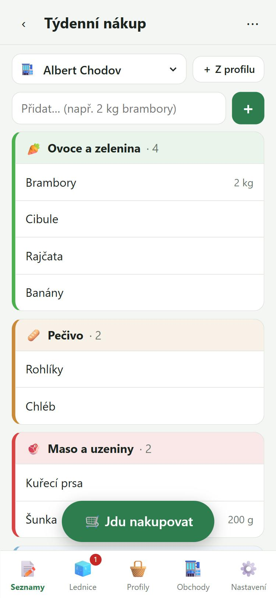
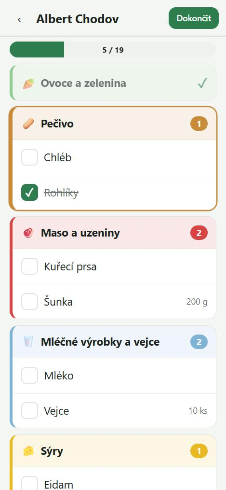
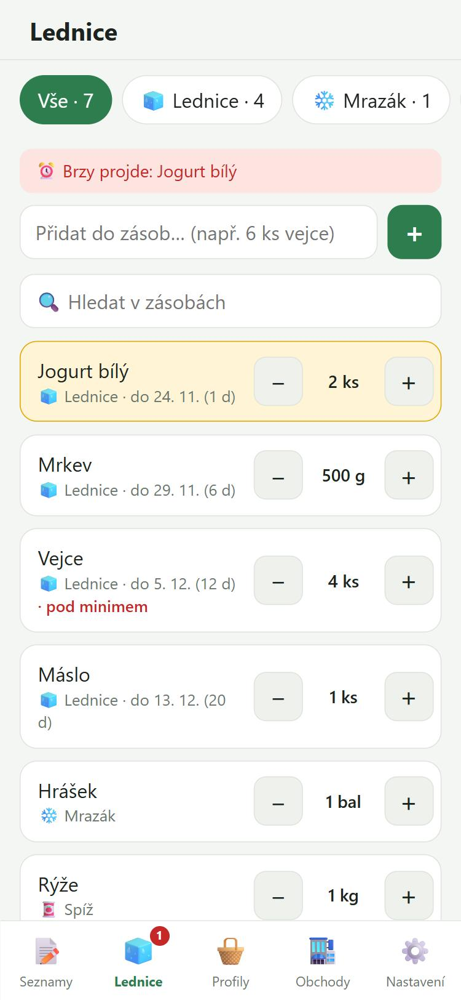
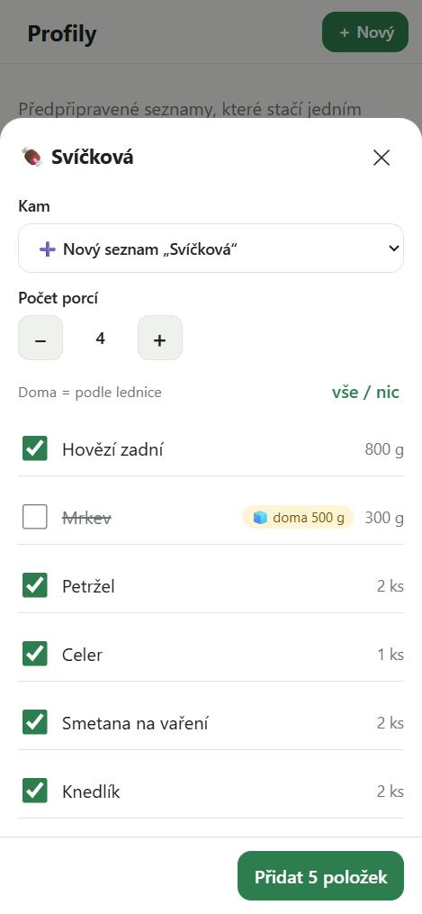
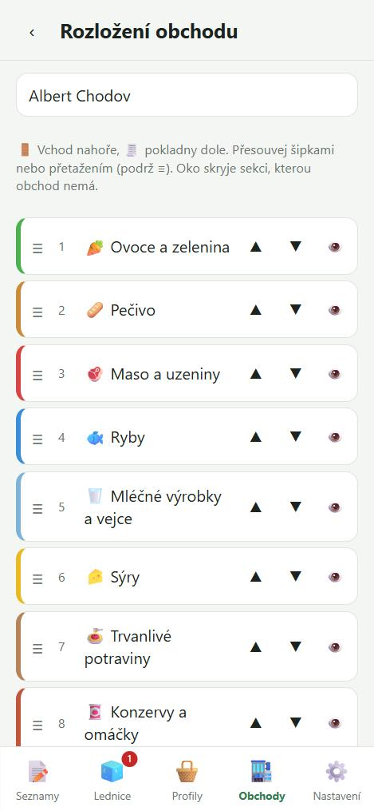
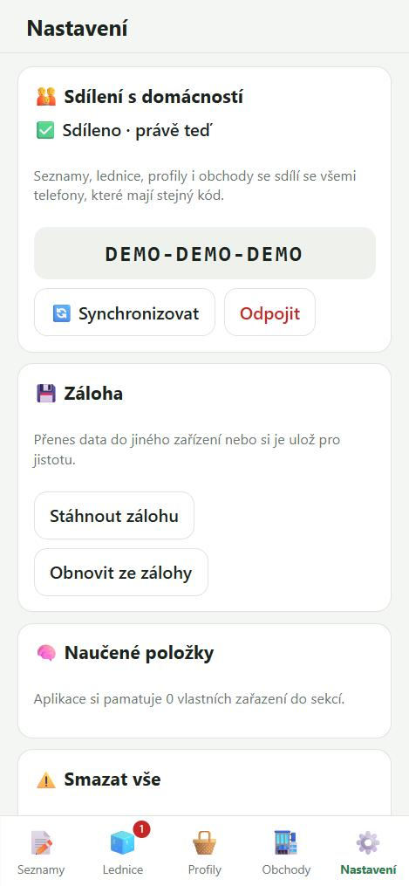

# Uživatelská příručka

## Spuštění na telefonu

Aplikace se otevírá v prohlížeči na adrese `https://váš-web.cz/nakupak/`. Aby se chovala jako
běžná aplikace (ikona na ploše, bez adresního řádku), přidejte si ji na plochu:

- **iPhone (Safari):** tlačítko **Sdílet** → **Přidat na plochu**.
- **Android (Chrome):** menu **⋮** → **Přidat na plochu** (nebo **Nainstalovat aplikaci**).

> **Důležité pro iPhone:** aplikace spuštěná z plochy má vlastní úložiště, oddělené od Safari.
> Používejte ji proto vždy přes ikonu na ploše. Smazáním ikony z plochy se smažou i data
> v telefonu. Se zapnutým [sdílením](#sdílení-s-domácností) se po opětovném zadání kódu stáhnou zpět.

Dole je lišta s pěti záložkami: **Seznamy · Lednice · Profily · Obchody · Nastavení**.

---

## Seznamy

### Přidávání položek

Do pole **Přidat…** napište položku a potvrďte. Aplikace:

- **zařadí položku do sekce obchodu** podle vestavěného slovníku (přes 570 potravin a zboží),
  a to i se skloňováním („cibuli“ i „cibule“ patří do Ovoce a zelenina),
- **rozpozná množství**: „2 kg brambory“, „mléko 1 l“ nebo „10 ks vejce“,
- **našeptává** podle slovníku a podle toho, co kupujete nejčastěji,
- **sloučí duplicity**: když dvakrát přidáte mléko, sečte množství,
- **upozorní, co máte doma**: „🧊 Doma máš: Máslo 1 ks“.

**Více položek najednou:** napište nebo vložte seznam oddělený čárkami nebo řádky, například
`rohlíky, mléko, 2 kg brambory, cibule`.

**Neznámá položka:** když aplikace položku nezná, zeptá se, do které sekce patří, a příště už
si to pamatuje.

### Úprava položky

Klepnutím na položku změníte název, množství, poznámku (např. „bio“) nebo sekci. Když položku
přesunete do jiné sekce, aplikace si to zapamatuje.

### Další možnosti

- **🏬 výběr obchodu** nahoře: seznam se seřadí podle rozložení zvoleného obchodu.
- **＋ Z profilu:** vloží položky z uloženého profilu (viz [Profily](#profily)).
- **⋯ (vpravo nahoře):** přejmenovat, uložit seznam jako profil, sdílet jako text, smazat.

 

---

## Nákupní režim

Tlačítkem **🛒 Jdu nakupovat** se seznam přepne do režimu pro obchod:

- sekce jdou **v pořadí, jak jimi v obchodě procházíte**,
- sekce, ve které právě jste (první s nekoupenými věcmi), je **zvýrazněná**,
- klepnutím položku **odškrtnete**,
- hotová sekce se **sbalí a dostane ✓**, takže hned vidíte, že se do ní nemusíte vracet,
- nahoře je **ukazatel postupu** (např. 5 / 19),
- displej během nákupu **nezhasne**.

### Dokončení nákupu

Po klepnutí na **Dokončit** aplikace nabídne **uložení koupených věcí do lednice**. U každé
položky lze upravit množství, místo uložení a datum spotřeby, nebo ji neukládat. Drogerie
a domácí potřeby jsou předem vypnuté. Koupené položky se pak ze seznamu odeberou.

 

---

## Lednice

Přehled toho, co máte doma, rozdělený podle míst: **Lednice, Mrazák, Spíž, Ostatní**.

- **＋ / −** mění množství. Když dojde na nulu, aplikace nabídne přidání na nákupní seznam.
- **Klepnutím na zásobu** nastavíte datum spotřeby, místo uložení a **minimální zásobu**.
  Tlačítky **Dojedeno** nebo **Vyhozeno** zásobu odstraníte.
- **Datum spotřeby:** zásoby, které brzy projdou, jsou žlutě, prošlé červeně. Nahoře je
  upozornění „⏰ Brzy projde“ a na záložce Lednice svítí počet.
- **Minimální zásoba:** např. vejce aspoň 6 ks. Když zásoba klesne pod minimum, položka se
  **sama přidá na nákupní seznam**.

Zásoby přibývají hlavně po nákupu (Dokončit → Uložit do lednice), ale dají se přidat i ručně
polem nahoře.

 

---

## Profily

Profil je uložený nákup, který nemusíte pokaždé vypisovat: „Týdenní nákup“, „Snídaně“,
„Grilovačka“, „Svíčková“…

**Vytvoření profilu:**

- v záložce **Profily** tlačítkem **＋ Nový**, nebo
- z existujícího seznamu přes **⋯ → Uložit jako profil**.

**Použití profilu:** tlačítko **Použít** (nebo rychlá volba na hlavní obrazovce Seznamů):

1. zvolíte, zda vytvořit **nový seznam**, nebo položky **přidat do existujícího**,
2. **věci, které máte doma, jsou předem odškrtnuté** (podle Lednice, „🧊 doma 500 g“),
3. odškrtnutím vyřadíte, co tentokrát nechcete,
4. **recept:** když má profil vyplněný počet porcí, můžete porce změnit a množství se přepočítají.

V úpravě profilu lze nastavit i **výchozí obchod**, profil **duplikovat** nebo **smazat**.

 

---

## Obchody

Každý obchod má vlastní **pořadí sekcí**, tedy cestu od vchodu k pokladnám.

- **▲ ▼** nebo **přetažením za ≡** změníte pořadí,
- **👁️** skryje sekci, kterou obchod nemá (její položky se zobrazí v Ostatní),
- **klepnutím na název** sekci přejmenujete nebo jí změníte ikonu,
- **＋ Vlastní sekce** přidá novou (např. „Bio a zdravá výživa“),
- **↺ Výchozí pořadí** vrátí původní stav.

Tip: při první návštěvě obchodu si projděte uličky a pořadí sekcí podle toho upravte. Příště už
bude seznam seřazený přesně podle vaší cesty.

 

---

## Sdílení s domácností

Se zapnutým sdílením mají všechny telefony v domácnosti **stejné seznamy, lednici, profily
i obchody**. Když jeden v obchodě odškrtne mléko, druhému zmizí do pár sekund.

### Připojení

1. Kód domácnosti najde správce webu ve WordPressu v **Nastavení → Nákupák**.
2. V aplikaci otevřete **Nastavení → Sdílení s domácností**, zadejte kód a klepněte na **Připojit**.
3. **První telefon:** jeho data se nahrají na web.
4. **Další telefony:** aplikace se zeptá, co s daty v telefonu:
   - **Použít jen sdílená data** (doporučeno): telefon převezme to, co je na webu,
   - **Spojit s daty v telefonu**: k sdíleným datům přidá i ta z telefonu.

### Jak se pozná, že sdílení funguje

V Nastavení je stav: **✅ Sdíleno · před 3 s**. Při problému se u záložky Nastavení objeví tečka:

- 🟠 **Bez připojení:** nevadí, aplikace funguje dál a změny odešle, až bude signál,
- 🔴 **Kód už neplatí:** správce vytvořil nový kód, zadejte ho znovu.

### Dobré vědět

- Když dva lidé ve stejnou chvíli upraví **stejnou** položku, platí ta úprava, která dorazí
  později. Úpravy **různých** položek se nikdy nepřepíší.
- **Odpojit** přeruší sdílení, data v telefonu ale zůstanou.
- **Smazat vše** v Nastavení smaže data jen v telefonu a odpojí ho. Data na webu zůstanou.
- Kód je jako heslo: dávejte ho jen lidem, se kterými chcete seznamy sdílet.

 

---

## Záloha

V **Nastavení → Záloha** můžete všechna data stáhnout do souboru a později je obnovit, třeba
v jiném telefonu. Hodí se před většími změnami nebo pokud sdílení nepoužíváte.

## Použití bez sdílení

Kód zadávat nemusíte. Aplikace pak funguje úplně stejně, jen data zůstávají v daném telefonu
a nikam se neposílají.
